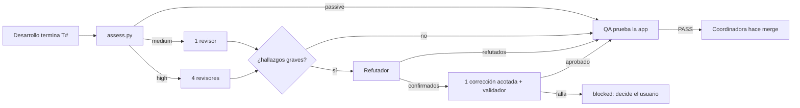

# Plan: absorber lo bueno de Gentle AI para no necesitarlo

**Respuesta corta:** modo-equipo ya copia casi todas las reglas de texto de Gentle AI (documento de la feature, RED/GREEN, línea de riesgo, seguridad, memoria). Le falta lo más valioso, que en Gentle AI es código y no texto: **la revisión de código independiente**. Este plan la reimplementa con scripts propios de Python, absorbe Judgment Day y las reglas de entrega que faltan, y deja fuera lo que es solo plomería de Gentle AI. Son 9 unidades de trabajo, unas 2.000 líneas en total, en este orden.

Base analizada: Gentle AI 4.4.0 (código Go en `~/go/pkg/mod/github.com/gentleman-programming/gentle-ai/v4@v4.4.0`, agentes en `~/.claude/agents/`, skills en `~/.claude/skills/`, bloques `gentle-ai:*` de `~/.claude/CLAUDE.md`).

## En simple

Gentle AI hace dos tipos de cosas:

- **Reglas escritas** (cómo planificar, cómo hacer commits, cuándo preguntar). Son texto: se copian en tus propias palabras y listo.
- **Un programa** (en Go) que congela una foto del código, le pide a revisores aislados que la lean, filtra los falsos positivos y deja constancia. Eso no se copia con texto: hay que **reconstruirlo** con scripts propios.

La brecha que vio tu amigo está en la segunda parte. Hoy modo-equipo tiene pruebas (QA prueba la aplicación funcionando), pero nadie **lee el código** buscando errores antes del merge.

## Inventario: qué tiene Gentle AI y qué hacemos con cada cosa

Leyenda: **[GO]** lo hace el programa · **[PROMPT]** es texto · **[HOOK]** lo ejecuta `settings.json`.

| # | Pieza de Gentle AI | Tipo | ¿Ya está en modo-equipo? | Decisión |
|---|---|---|---|---|
| 1 | Foto congelada del código a revisar (árboles git con índice temporal) | GO | No | **Reimplementar** (`freeze.py`) |
| 2 | Clasificación de riesgo `review assess` (passive / medium / high por señales concretas) | GO | Solo la línea `Risk:` en texto | **Reimplementar** (`assess.py`) |
| 3 | Revisores aislados por ángulo (riesgo, resiliencia, legibilidad, confiabilidad), sin herramientas ni configuración | GO + agentes | No | **Reimplementar** (`review_run.py` + prompts propios) |
| 4 | Formato JSON de hallazgos con severidad, tipo de evidencia y causalidad | GO valida | No | **Reimplementar** (validador en `review_run.py`) |
| 5 | Refutador: un segundo revisor que intenta tumbar cada hallazgo grave | GO + agente | No | **Reimplementar** |
| 6 | Una sola corrección acotada (presupuesto `min(200, ceil(líneas/2))`, mínimo 2) + validador | GO | No | **Reimplementar** |
| 7 | Constancia de revisión (Gentle la borra tras aceptar y deja una lápida) | GO | No | **Reimplementar más simple**: recibo atado al árbol revisado |
| 8 | Lista de 6 ítems de alto riesgo y `--escalate-item` | GO + PROMPT | Parcial (lista sin números) | **Absorber** y numerar |
| 9 | Judgment Day: dos jueces ciegos, arreglo solo de lo confirmado, máximo 2 rondas | PROMPT | No | **Absorber** (modo de revisión opcional) |
| 10 | Commits por unidad de trabajo, porciones de ~400 líneas, PR encadenados | PROMPT | Parcial (commits en la rama) | **Absorber** |
| 11 | Prueba diferencial contra una copia del commit base en `mktemp -d` | PROMPT | No | **Absorber** |
| 12 | Tarea chica vs grande con la prueba de "¿se puede retomar solo con el diff?" | PROMPT | No (el Paso 0 es otra pregunta) | **Absorber** |
| 13 | Copia del documento de la feature en Engram y procedimiento para retomar | PROMPT | No | **Absorber** |
| 14 | Presupuesto de evidencia (3 llamadas / ~10k tokens; más de 5 búsquedas = explorador) y "superficies de edición permitidas" | PROMPT | Parcial (archivos propios y prohibidos) | **Absorber** |
| 15 | Preguntas bloqueantes sin pérdida, con validación de respuestas | PROMPT | Parcial | **Absorber** la validación |
| 16 | Rutas exactas de skills en cada encargo (`## Skills to load before work`) | PROMPT | No | **Absorber** |
| 17 | Hook `Stop` que frena el "listo" si hay cambios sin revisar | HOOK | No | **Reimplementar, opcional** |
| 18 | Registro de skills regenerado en cada mensaje (`.atl/skill-registry.md`) | GO + HOOK | Tiene búsqueda a demanda | **Descartar**: la lista de skills de la sesión ya cumple esa función |
| 19 | Key Learnings al final de cada trabajador | PROMPT | No | **Descartar**: Engram ya guarda con `mem_save` |
| 20 | Consentimiento por candidato, recibos con quema, transacciones con `LOCK` | GO | No | **Descartar**: complejidad sin beneficio para un solo usuario |
| 21 | Telemetría, `sync`, `install`, persona, codegraph | GO | — | **Descartar**: no son parte del flujo de trabajo |

## Cómo queda el flujo con revisión

- **Quién la ejecuta:** la sesión de QA (ya es de solo lectura) o un fork suyo. Los revisores corren como procesos `claude -p` aislados, no como sesiones nuevas, así que no cuentan contra el límite de 4 sesiones.
- **Nueva compuerta de merge:** `merged` exige un recibo de revisión cuyo árbol coincida con el de la rama. Si alguien cambia el código después de revisarlo, el árbol cambia y el recibo deja de servir.
- **Costo:** los revisores gastan del mismo plan. El Paso 1 debe sumar su costo al pronóstico (1 o 4 revisores × tamaño del diff) y el Paso 6 debe medirlo.

## Unidades de trabajo (en orden)

Cada unidad es un commit con sus pruebas y su documentación. Las pruebas usan `unittest` como las actuales y corren en la CI de los 3 sistemas.

| U | Qué | Archivos | Pruebas | Riesgo | Tamaño aprox. |
|---|---|---|---|---|---|
| U1 | `assess.py`: port de las señales de riesgo (rutas con auth/security/payments/webhook, shell y workflows, bit ejecutable, lanzamiento de procesos, catálogo de patrones peligrosos por CWE, "passive" solo para docs/imágenes no operativos) + `--escalate-item 1-6` | `scripts/review/assess.py`, `tests/test_assess.py` | Un caso por señal, un caso "passive", uno "medium", la escalada que sube y nunca baja | ítem 6 (si el filtro falla, nada avisa) | ~400 |
| U2 | `freeze.py`: árbol base y árbol candidato con `GIT_INDEX_FILE` temporal y `write-tree`, sin tocar el índice real; recibos en `.git/modo-equipo/reviews/<árbol>.json` | `scripts/review/freeze.py`, `tests/test_freeze.py` | Repo temporal en `mktemp -d`: el índice real queda igual, un cambio posterior invalida el recibo | ítem 1 (escribe en `.git`) | ~250 |
| U3 | `review_run.py`: lanza revisores con `claude -p --tools "" --setting-sources "" --no-session-persistence --permission-mode dontAsk` desde una carpeta vacía, con el diff por stdin; valida el JSON; corre el refutador; tope de diff de 4 MiB (sin truncar: se detiene) | `scripts/review/review_run.py`, `references/review-lenses.md`, `tests/test_review_run.py` | Un `claude` falso por variable de entorno: JSON válido, inválido, vacío, diff demasiado grande | ítem 2 (lanza procesos) | ~500 |
| U4 | Flujo en `SKILL.md`: dónde entra la revisión, corrección única con presupuesto, validador, compuerta de merge, costo en Pasos 1 y 6 | `SKILL.md`, `docs/01`, `docs/03` | Revisión estructural: cada paso y archivo citado existe | ítem 3 (cambia el contrato de la skill) | ~150 |
| U5 | Judgment Day propio como revisión opcional ("revisión doble") para riesgo alto o cuando el usuario la pida; agentes incluidos en el plugin | `agents/` del plugin, `references/judgment.md` | Revisión estructural | ninguno | ~200 |
| U6 | Reglas de entrega: tarea chica vs grande, commits por unidad, porciones de ~400 líneas, PR encadenados, prueba diferencial, copia en Engram y cómo retomar | `SKILL.md` (Pasos 3 y 5), `docs/02` | Revisión estructural | ninguno | ~150 |
| U7 | Reglas de delegación: presupuesto de evidencia, superficies de edición permitidas en cada encargo, rutas exactas de skills, validación de respuestas a preguntas bloqueantes | `SKILL.md` (Pasos 2, 4 y 5) | Revisión estructural | ninguno | ~100 |
| U8 | Hook `Stop` opcional: si la rama de la tarea tiene un árbol sin recibo, recuerda una sola vez revisar antes de decir "listo" | `hooks/hooks.json` del plugin, `scripts/review/stop_hook.py`, prueba | Avisa una vez por árbol, nunca bloquea dos veces | ítem 5 (hook en el entorno) | ~150 |
| U9 | Cierre: la sección "Gentle AI OFF" pasa a "modo-equipo es autosuficiente"; QA y revisores nunca usan el modelo barato; README, `docs/05`, `docs/06`, versión 1.4.0 | `SKILL.md`, `README.md`, `docs/05`, `docs/06`, `plugin.json` | Revisión estructural + suite completa | ítem 3 | ~150 |

Total aproximado: 2.050 líneas. Con más de 400 líneas, conviene entregarlo en PR encadenados: **U1+U2**, **U3**, **U4+U5**, **U6+U7** y **U8+U9**.

## Decisiones que necesito de ti (de a una, cuando empecemos)

| Decisión | Mi recomendación | Alternativa |
|---|---|---|
| Aislamiento de los revisores | Proceso `claude -p` sin herramientas ni configuración, igual que Gentle AI: el revisor no puede ver nada más que el diff | Subagente con `tools: []`: más simple, pero hereda tu `CLAUDE.md` y es menos independiente |
| Hook `Stop` (U8) | Incluirlo, desactivado por defecto y activable con una pregunta | No incluirlo: menos piezas, pero depende de que el modelo se acuerde |
| Mientras modo-equipo está activo, ¿se siguen ignorando los bloques de Gentle AI? | Sí: dos orquestadores dando órdenes distintas se pisan. Ya no es "apagar Gentle", es "una sola autoridad a la vez" | Convivir: riesgo de revisiones dobles y reglas contradictorias |

## Límites y riesgos del plan

- **Licencias:** Gentle AI es MIT y el archivo [`NOTICE`](../NOTICE) ya le da la atribución, así que el texto copiado de Gentle AI queda cubierto. Las skills marcadas Apache-2.0 (por ejemplo `judgment-day`) exigen además conservar su propio aviso junto al texto copiado. Lo más limpio sigue siendo reescribir con tus palabras, como ya hace la skill.
- **Pruebas de los revisores:** la CI no puede llamar a `claude`. Se prueba con un ejecutable falso; la calidad real de la revisión solo se ve usándola en un proyecto.
- **El filtro de riesgo es heurístico:** se basa en nombres de ruta y patrones. Puede marcar de menos. Por eso se mantiene `--escalate-item` para subir el nivel a mano, nunca para bajarlo.
- **Sigue sin uso real:** no existe todavía `cost-history.md`. Después de U4 conviene una corrida real del modo `full` antes de seguir con U5-U9, para medir el costo de los revisores.

## Siguiente paso

Pendiente: el dueño del repo lo implementará más adelante. Punto de partida sugerido: la opción mínima (un revisor como subagente sin herramientas, más el refutador y una corrección única, todo en `SKILL.md`), probarla en un proyecto real y, si encuentra errores útiles, seguir con U1-U4.
